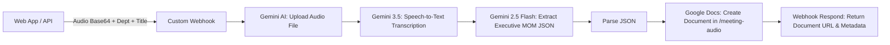

# Make.com Scenario Blueprint: Tamilpreneur MOM Studio

This directory contains the complete exported blueprint for the **MOM - Gemini STT Studio Webhook** automation on Make.com.

## Architecture

## Modules in this Blueprint:
1. **Module 1 (`gateway:CustomWebHook`):** Custom Webhook listening for instant HTTP POST requests from MOM Studio.
2. **Module 11 (`gemini-ai:uploadAFile`):** Uploads binary audio stream to Google Gemini File API.
3. **Module 12 (`gemini-ai:createACompletionGeminiPro`):** Model `gemini-3.5-transcribe` executes full meeting audio transcription.
4. **Module 6 (`gemini-ai:simpleTextPrompt`):** Model `gemini-2.5-flash` extracts decisions, action items, participants, deadlines as structured JSON.
5. **Module 7 (`json:ParseJSON`):** Validates and parses the structured MOM JSON schema.
6. **Module 18 (`google-docs:createADocument`):** Dynamically formats and creates a styled Google Doc inside `/meeting-audio` Google Drive folder.
7. **Module 19 (`gateway:WebhookRespond`):** Returns the live `documentUrl`, `id`, `webViewLink`, `title`, and `date` synchronously back to the web UI.

## How to Import:
1. Open [Make.com](https://eu1.make.com/).
2. Create or open your Scenario.
3. Click the **...** menu in the bottom toolbar -> **Import Blueprint**.
4. Select `mom-gemini-stt-webhook-blueprint.json`.
5. Connect your Google account connection for Google Docs and Google Gemini API key.
